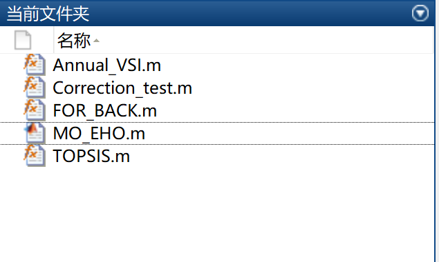

# Improved Elephant Herding Optimization Algorithm for Multi-Objective DER Inclusion in Power Distribution Systems (Matlab Implementation)

Elephant herding optimization algorithm (Matlab code implementation)
Algorithm explanation: Improved elephant herding optimization algorithm for multi-objective DER accommodation in power distribution systems (Matlab implementation)

## Images

<!-- PAYMENT_BLOCK -->

## Get this dataset

- Payment link (Stripe): [Buy now](https://buy.stripe.com/3cs8yP7sY87d0vu9AB)
- Payment QR code: 

<!-- /PAYMENT_BLOCK -->
